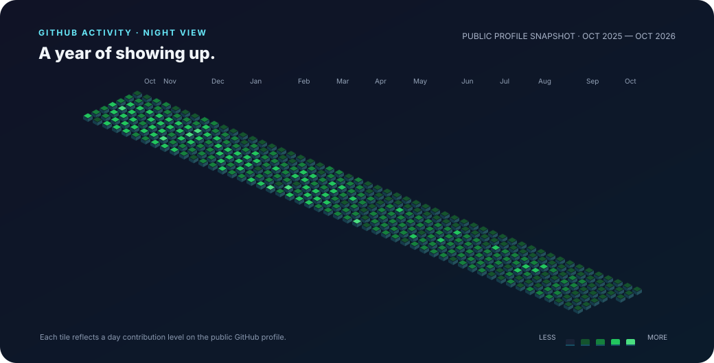
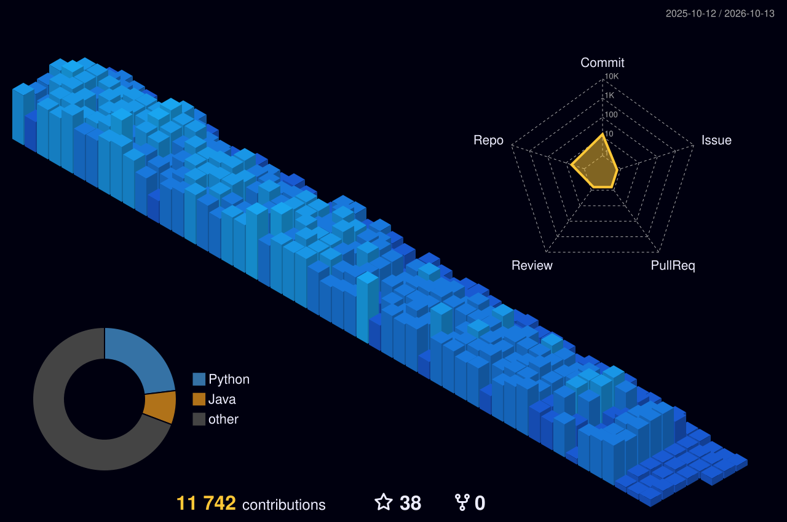

  

  <picture>
    <source media="(max-width: 600px)" srcset="./assets/profile_hud_mobile.svg">
    
  </picture>

<h2 align="center">✦ A year of showing up ✦</h2>

  

  

  
  

  

  
  
  

  

